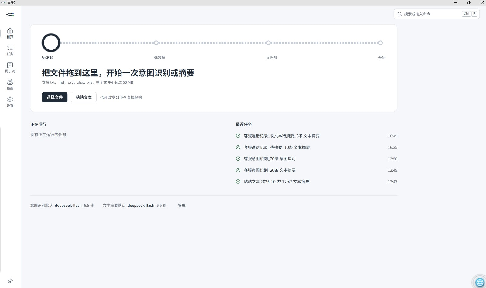
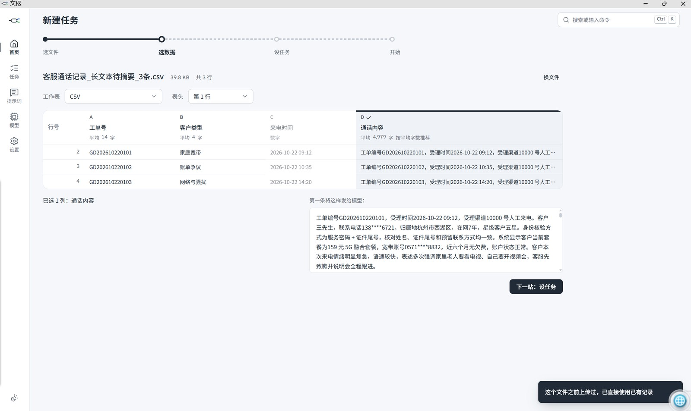
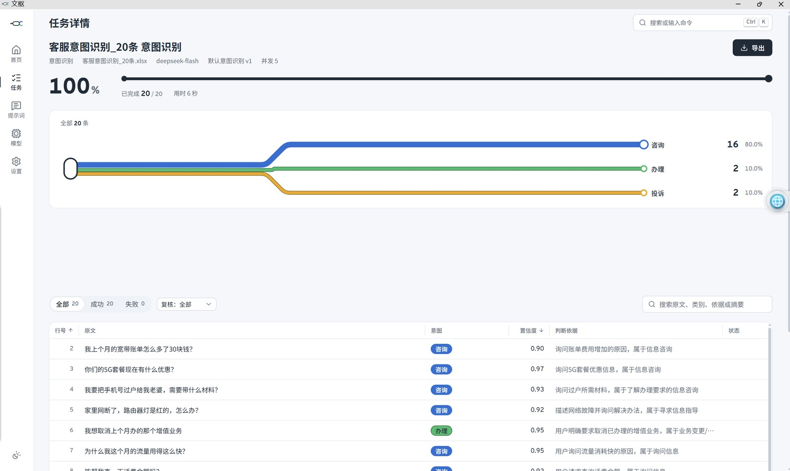
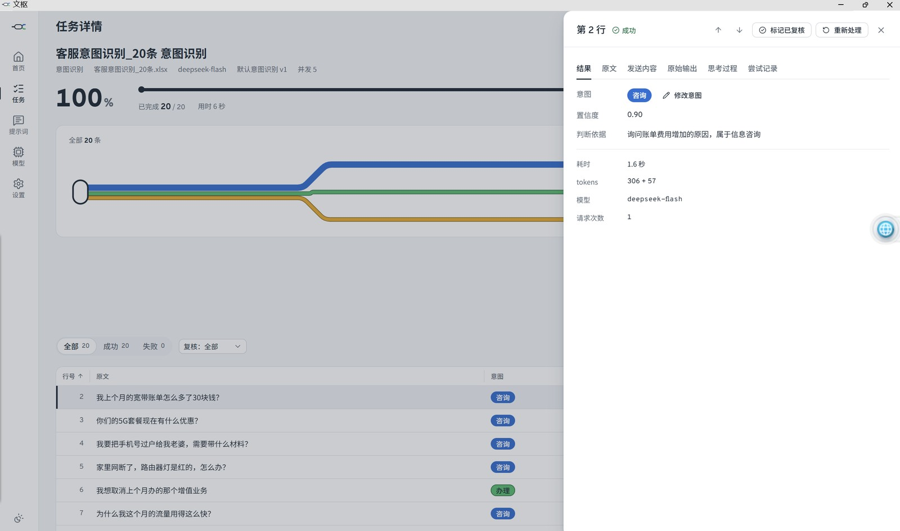

# 文枢 WenShu · 客服文本批量意图识别与摘要工作台

[简体中文](README.md) | [English](README.en.md)


文枢（WenShu）是一个在本地运行的**客服文本批量工作台**：把通话记录、工单、回访文本按行交给大模型做**意图识别**或**文本摘要**，结果可以逐条**人工复核**、修正，并导出 Excel / CSV。支持 OpenAI 兼容接口，文件和密钥留在本机。

Local-first batch **intent classification** and **text summarization** workbench for customer-service teams. Review, correct, and export results — your files and API keys stay on your machine.

<p align="center">
  
</p>

## 为什么做文枢

客服一线、质检和运营每天都在处理大量文本，但常见的工作方式是：打开表格，逐条读，逐条判断，再把结论打回表格。模型并不缺，缺的是一个一线人员敢用、用得顺、结果能复核的工具。

文枢先解决四件事：

- **读不完**：成百上千条记录，人工逐条读，耗时且容易疲劳。
- **判不一**：同一类问题，不同人给不同标签，口径难统一。
- **摘不出**：长文摘要靠人写，慢、容易漏重点，格式还不统一。
- **改不动、留不下**：模型结果有错时，改了没有痕迹；导出还要手工拼表，复核过程无法追溯。

## 功能

- **意图识别**：按提示词里定义的类别批量判断，支持置信度、判断依据、类别统计和线网图。
- **文本摘要**：长文本自动分段落、分段摘要、合并；支持修改摘要主旨并保留模型原摘要。
- **人工复核**：意图只能改成提示词里列出的类别；修改前后都可见；可标记已复核；导出带“修正前”列。
- **提示词工坊**：内置意图识别、文本摘要两套模板，可编辑、试运行、查看版本历史、恢复内置默认。
- **模型可换**：任意 OpenAI 兼容接口；内置演示模型，不配 Key 也能完整体验。
- **本地优先**：只监听 `127.0.0.1`，单用户、免登录；API Key 用本机密钥加密保存；不收集使用数据。

<p align="center">
  
</p>

## 快速开始

### 方式一：便携版（推荐给只想使用的人）

1. 打开 [Releases](https://github.com/futureYYY/wenshu-workbench/releases)，下载最新的 `WenShu.zip`。
2. 解压到任意目录（支持中文和空格路径）。
3. 双击 `WenShu.exe`。

自带 Python 运行时，不需要安装 Python 或 Node。第一次启动会在 exe 旁边创建 `data` 目录；内置演示模型可直接体验，接真实模型只需在“模型”页填写接口地址、模型名和 API Key。

### 方式二：源码版（适合想看代码、改代码的人）

需要 **Python 3.13**；只有修改前端源码时才需要 **Node.js 24**。

```bat
git clone https://github.com/futureYYY/wenshu-workbench.git
cd wenshu-workbench
启动文枢.bat
```

第一次启动会自动创建 `backend\.venv`、安装依赖并构建界面。也可以在项目根目录运行 `scripts\dev.bat` 进行前后端分离开发（后端 18765，前端 5173）。

## 怎么用

1. **上传**：把 `csv`、`xlsx`、`xls`、`txt`、`md` 拖进首页，或点击选择文件 / 粘贴文本。
2. **选数据**：点击表头选择要处理的文本列；多列会按拼接方式合并。
3. **设任务**：选择意图识别或文本摘要、提示词、模型、并发和处理条数。
4. **运行**：实时查看进度、并行轨道、结果表和线网图。
5. **复核并导出**：逐条修正、标记已复核，导出 xlsx / csv；导出会使用修正后的值，并附修正前的内容。

<p align="center">
  
</p>

<p align="center">
  
</p>

## 接入模型

文枢只要求接口兼容 OpenAI 的 `/chat/completions`，不绑定厂商：

- 在“模型”页填写 `base_url`、模型名和 API Key；
- 支持设置温度、最大输出、上下文长度、超时、并发、JSON 模式和额外请求头/请求体；
- Key 只在本地加密保存，界面只显示掩码；
- 不配置真实模型时，使用内置演示模型体验完整流程（结果是模拟的）。

默认自定义模型可以写在 `backend/models.local.json`（不提交，参考 `backend/models.local.json.example`）。这个文件是明文 Key，请只放在自己的电脑上，不要提交到 Git。

## 适合谁

- 客服一线：批量整理通话记录、回访文本；
- 质检 / 运营：统一意图口径、抽检和复核；
- 需要批量处理文本的个人和小团队。

## 隐私与安全

- 后端只监听 `127.0.0.1`，不对外网开放；
- 文件、任务结果和密钥保存在本机数据目录；
- API Key 使用本机 `secret.key` 加密，数据库被单独拷走也无法直接还原；
- 不收集使用数据、不做遥测；
- 模型请求只会发往你在“模型”页配置的接口，请使用符合合规要求的模型服务；
- 仓库不包含任何真实 Key；测试数据均为虚构。

## 技术栈

- 后端：Python 3.13、FastAPI、SQLAlchemy 2（异步）、SQLite
- 前端：Vue 3、Vite、TypeScript、Tailwind CSS、Reka UI
- 打包：PyInstaller；便携版自带运行时

更多设计细节见 [`docs/`](docs/)：需求、架构、数据库、接口、提示词、界面、打包与验收。

## 路线图

- [ ] 更多任务类型（分类以外的结构化抽取）
- [ ] 提示词模板分享与导入
- [ ] 批量任务队列与更细的限速控制
- [ ] 更完善的可访问性与窄屏适配

欢迎在 Issues 里提出你真实的使用场景。

## 贡献

欢迎 Issue、Pull Request、提示词模板和使用反馈：

1. Fork 本仓库；
2. 从 `main` 创建分支；
3. 提交前运行 `backend\.venv\Scripts\python.exe -m pytest backend\tests -q`、`npm run typecheck`、`npm run test`；
4. 在 PR 里说明改动、验证方式和影响范围。

## 赞赏与交流

如果文枢帮你节省了时间，可以请我喝杯咖啡。**赞赏完全自愿，不影响任何功能。**

合作、定制、部署或使用问题，也欢迎加微信交流；添加时请备注“文枢 + 来意”。

| 支付宝 | 微信支付 | 合作微信 |
| --- | --- | --- |
|  |  |  |

## 许可证

[MIT](LICENSE) © 2026 齐雨凡

如果这个项目对你有帮助，欢迎点一个 Star。
